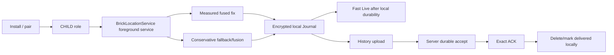
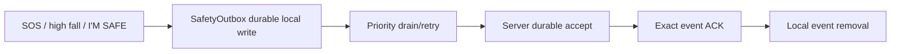

# Brick V1 — Phase 8C Lifecycle and Recovery Report

Production freeze: `967e5d5ceb7e485af997eb0f6380e9544cd39e79`

## Normal child lifecycle

The foreground service is the live tracker. WorkManager is recovery/housekeeping, not the primary live tracking engine. Boot/package/time/network recovery paths re-establish the required services/schedules subject to role, Deep Off and post-purge guards.

## Safety lifecycle

SOS active state is committed atomically with the SOS transition event. High-fall event and protection deadline are committed atomically. I'M SAFE uses the same local-first outbox and remains queued across reopen until exact ACK.

## Location loss/reacquisition

Only an accepted FUSED sample with a valid original monotonic measurement time advances measured-location freshness. Rejected/stale callbacks cannot suppress reacquisition. A measured-generation guard prevents a fallback computation from overwriting a fresh accepted measured fix that arrives concurrently.

## Recovery supervisor boundary

Subsystem failures are isolated. The live tracker can repair location subscription/reacquisition without requiring an app reboot. Network recovery kicks live/history drains. Shizuku is optional and isolated behind a recoverable executor lane; a wedged privileged call must not block Core.

## Maintenance, Deep Off and deprovision

Device Owner policy changes are recorded in the Policy Ledger with provenance before mutation. Deprovision reverses only Brick-created changes whose provenance is valid. Missing/corrupt provenance fails closed.

Deprovision proceeds through the defined stages rather than a broad reset. At `PURGE_BRICK` or later, independently invokable Android entry points are guarded so they cannot recreate tracking, diagnostics, activity, companion, safety, evidence or recovery state. The remaining allowed behavior is the minimal uninstall/release path. WorkManager cancellation/drain is explicitly checked.

## Physical-device boundary

ColorOS-specific process resurrection, OEM background limits, real reboot/update persistence and Device Owner interactions cannot be proven by AOSP emulator. Those lifecycle items move to Phase 9 as `IMPLEMENTED — DEVICE VERIFICATION PENDING`.
