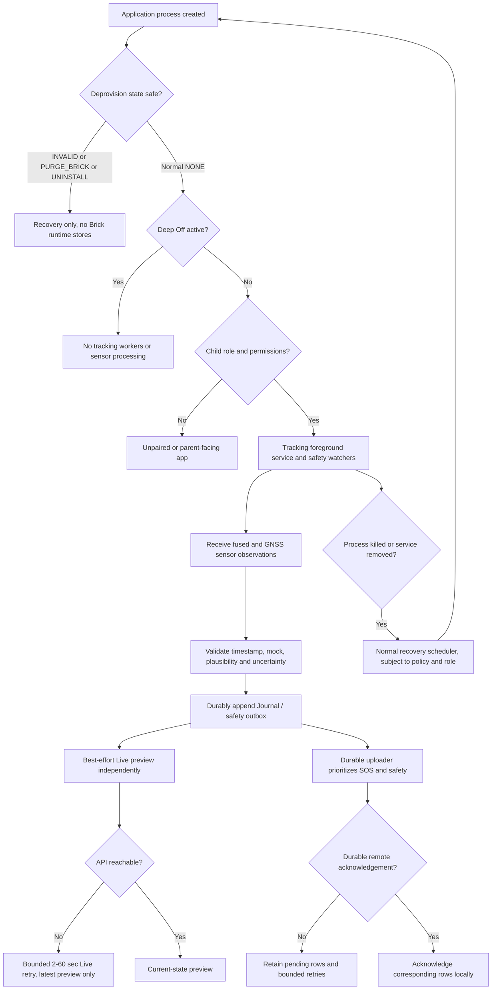
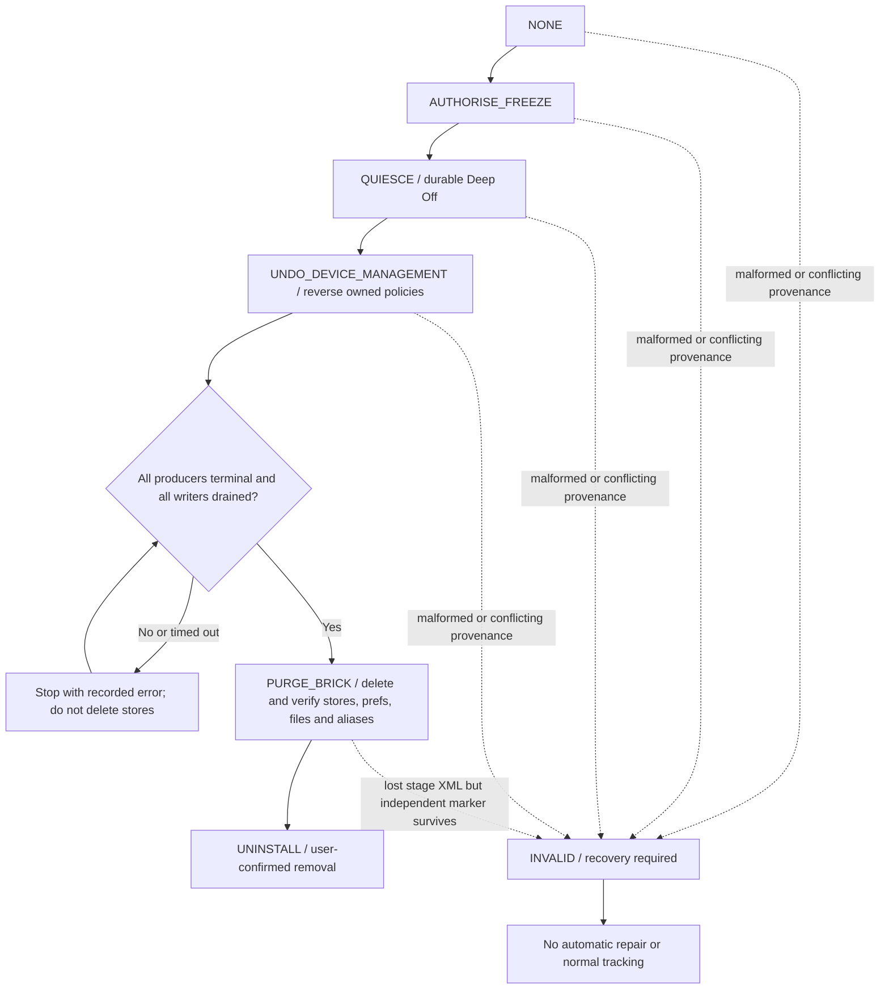
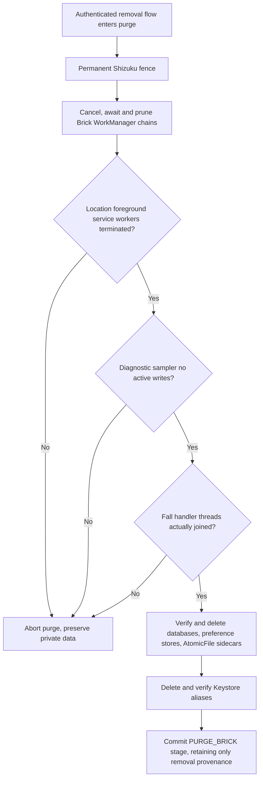

# Brick V1 Phase 8C.3 — Android lifecycle and removal state diagram

**Date:** 2026-11-04. **Source:** `BrickApplication.kt`, `BrickLocationService.kt`, `DeprovisionManager.kt`, `DeepOffManager.kt`, `RecoveryScheduler.kt`, `DiagnosticMonitor.kt`, `FallDetectorRuntime.kt`, `ShizukuPrivilegedBridge.kt`. The diagram is a code-path model, **not** an assertion that all CI tests have passed.

## Normal Android service lifecycle

A callback arriving now with an older location measurement cannot reset the measured-fix age. Rejected Fused callbacks may yield conservative fallback estimates, but cannot impersonate a fresh accepted measurement. Emergency SOS outbox persists before network delivery; Live UI preview is not an emergency storage authority.

## Monotonic authorised deprovision lifecycle

The entire state sequence is monotonic. `INVALID` **does not mean successfully purged**; it means evidence of state is insufficient and the app must remain fail-closed. The independent, non-sensitive no-backup origin guard prevents loss of the sole deprovision preference XML from resetting the app to `NONE`. Total loss of **both** independent anchors is not distinguishable from a fresh install with the available local evidence; it is an explicitly declared limitation, not a PASS claim.

## Producer termination barrier before PURGE_BRICK

The gate must not claim termination after merely calling `stopService`, `shutdownNow`, `Future.cancel(false)`, or `quitSafely`. Each is an asynchronous request. A hung writer produces an explicit bounded failure rather than a false-success purge.

**Current audit status:** The original SOS/HIGH-fall, post-purge startup, Shizuku, crypto, WorkManager and corruption tests have recorded green emulator runs. The newly extended service, diagnostics and fall producer-drain tests still require their exact-source passing run before the P8C-008 finding can be formally closed. Physical OPPO process-kill and background power behavior remain Phase 9 verification.
